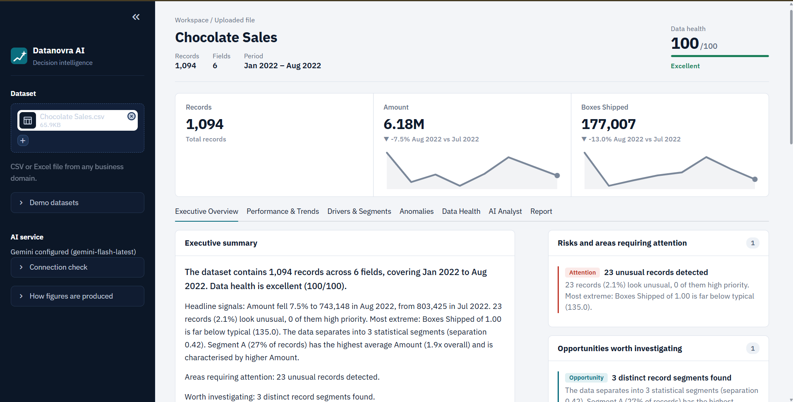
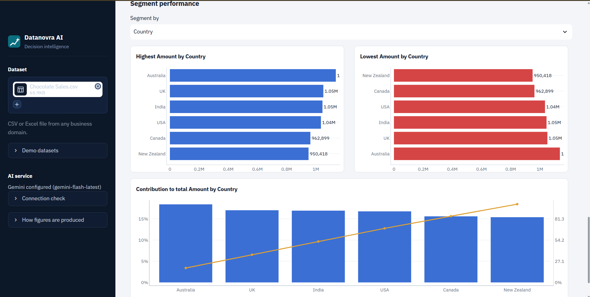
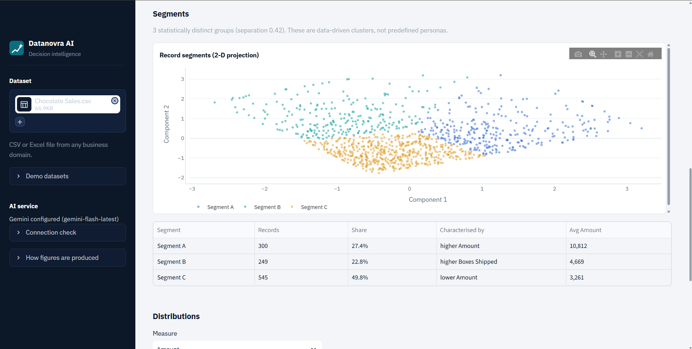
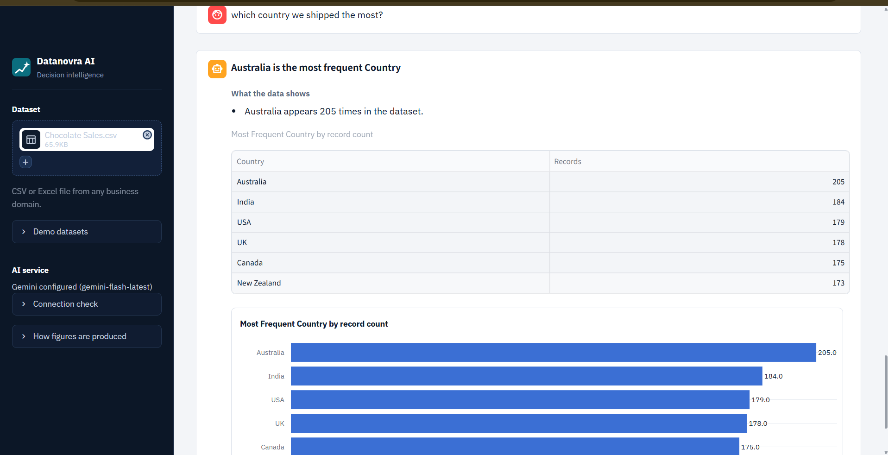
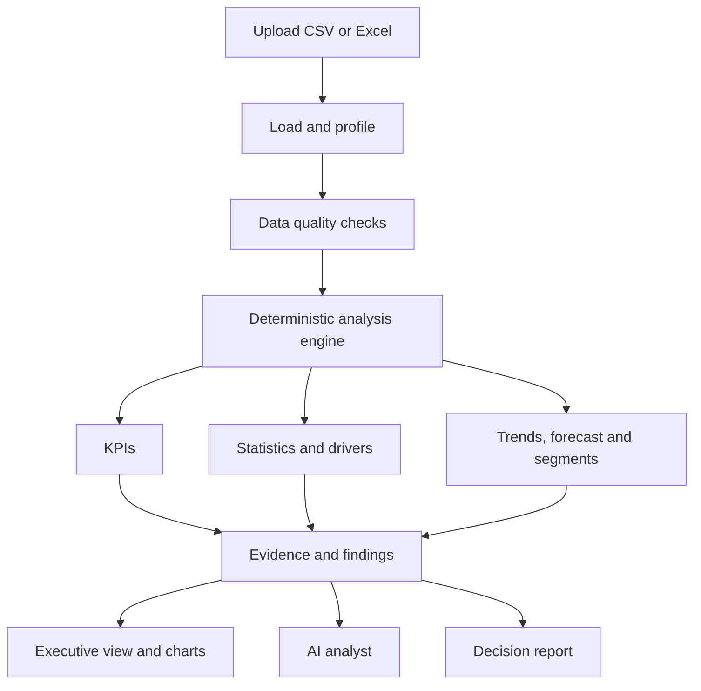

<div align="center">

# AI Data Detective

**From raw data to evidence-based decisions.**

An analytics workspace that profiles any CSV or Excel dataset, surfaces what changed, what stands out and what deserves a closer look, and answers follow-up questions in plain language, with every number computed and never invented.


<!-- Replace with a screenshot of the Executive Overview tab -->


</div>

---

## Why this project exists

Spreadsheets hide patterns. Dashboards only show the metrics someone decided to build in advance. General-purpose AI chat can explain a dataset fluently, but it can also state numbers that were never computed.

AI Data Detective takes a different approach: **a deterministic analysis engine does the math, and the AI layer only plans questions and explains verified results.**

| | Static dashboard | General AI chat | AI Data Detective |
|---|---|---|---|
| Works on any uploaded dataset | Needs setup per dataset | Yes | Yes |
| Findings appear without asking | Only predefined metrics | No | Yes, automatic executive view |
| Numbers are computed from the data | Yes | Not guaranteed | Yes, always |
| Says when the data can't answer a question | No | Rarely | Yes, by design |

---

## Highlights

- **Executive view in one upload.** KPIs with sparklines, a written summary, ranked findings, risks, opportunities and recommended next investigations are generated automatically.
- **Evidence before explanation.** Figures come from the analysis engine. The AI layer interprets and explains them, and a number is shown only when it is backed by computed evidence.
- **Honest about limits.** If the data can't support an analysis (no time column, too few periods, no reliable drivers), the app says so and explains why instead of guessing.
- **Multi-step questions.** Asking "why did revenue decline?" runs a breakdown of what moved the latest change, not a one-shot guess.
- **Forecasts with a track record.** Forecasts report their own back-test error and reliability rating.
- **Shareable output.** Export a full decision report as HTML (with charts) or Markdown.

---

## Screenshots

<!-- Add your own images to docs/screenshots/ and keep these filenames, or edit the paths. -->

| Executive overview | Performance and trends |
|---|---|
|  |  |

| Drivers and segments | AI analyst |
|---|---|
|  |  |

---

## A tour of the workspace

| Tab | What you get |
|---|---|
| **Executive Overview** | Summary, key findings, risks, opportunities, recommended investigations and the most significant changes |
| **Performance and Trends** | Period-over-period and year-over-year change, trend significance, seasonality, forecast with back-test, and a breakdown of what moved the latest change |
| **Drivers and Segments** | Fields most associated with the primary measure (out-of-sample R² or AUC), correlation matrix, data-driven clusters, and distributions |
| **Anomalies** | Statistically unusual records and unusual periods, prioritised, with a clear note that outliers are not confirmed errors |
| **Data Health** | A 0 to 100 score (40% completeness, 30% uniqueness, 30% validity), itemised issues with suggested actions, and how the dataset was interpreted |
| **AI Analyst** | Natural-language questions over the dataset, with facts, interpretation, next steps, limitations and the basis for each answer |
| **Report** | Downloadable decision report built only from the verified analyses |

---

## How it works



**The trust model:** the engine computes measurable results. The AI layer is optional and is limited to planning which analysis a question needs and explaining the verified output. It never substitutes invented values for computed evidence.

---

## Tech stack

| Area | Technologies |
|---|---|
| Language | Python |
| Data handling | Pandas, NumPy |
| Statistics | SciPy, Statsmodels |
| Machine learning | Scikit-learn |
| Visualisation | Plotly |
| Interface | Streamlit |
| Validation | Pydantic |
| AI integration | Configurable language-model providers (OpenAI and Gemini supported) |
| Testing | Pytest |

---

## Project structure

```text
AI-Data-Detective/
├── web_app.py            # Streamlit interface
├── detective/
│   ├── dataset.py        # Loading and field identification
│   ├── engine.py         # Orchestrates analysis and findings
│   ├── copilot.py        # Question planning and evidence-based answers
│   ├── llm.py            # Optional model-provider integration
│   ├── visuals.py        # Plotly charts
│   ├── anomalies.py      # Unusual records and periods
│   ├── quality.py        # Data-quality scoring
│   ├── drivers.py        # Drivers and relationships
│   ├── segments.py       # Clustering
│   ├── timeseries.py     # Trends, seasonality, forecasting
│   ├── performance.py    # Group comparisons and contribution
│   └── report.py         # HTML and Markdown reports
├── sample_data/          # Demo datasets
├── tests/
├── .streamlit/config.toml
├── requirements.txt
└── README.md
```

---

## Design decisions

- **Compute first, explain second.** Keeping calculation and language generation in separate modules makes every figure traceable and testable.
- **Refuse weak answers.** Driver analysis reports nothing when no field predicts the measure reliably. Segmentation, forecasting and anomaly detection each state when they are unavailable.
- **Associations are labelled as associations.** Drivers and correlations are never presented as proven causes.
- **Incomplete periods are excluded.** A partial final period is flagged and left out of comparisons so it can't distort a trend.
- **Separation of concerns.** Loading, analysis, AI integration, charts and reporting are independent modules, so each can change without breaking the others.

---

## Getting started

**Prerequisites:** Python 3.11 or later and Git.

```bash
# 1. Clone
git clone https://github.com/ramya63822/ai-data-detective.git
cd ai-data-detective

# 2. Create and activate a virtual environment (Windows PowerShell)
python -m venv venv
.\venv\Scripts\Activate.ps1

# 3. Install dependencies
python -m pip install --upgrade pip
pip install -r requirements.txt

# 4. Run
python -m streamlit run web_app.py
```

Open `http://localhost:8501`, then either upload a CSV or Excel file from the sidebar or open one of the demo datasets.

### Optional: enable the AI analyst

The deterministic analysis works without any API key. To enable AI-assisted question planning and explanation, create a local `.env` file. For Gemini:

```env
AI_PROVIDER=gemini
GEMINI_API_KEY=your_api_key_here
GEMINI_MODEL=your_configured_model
```

Variable names must match what `detective/llm.py` expects. Never commit `.env`.

---

## Testing

```bash
python -m pytest -q
python -m compileall -q web_app.py detective tests
```

The syntax check confirms the code compiles, not that every feature behaves correctly. The test suite covers analytical correctness, and the manual checklist below covers what automated tests don't.

- Loading supported datasets, and handling missing, malformed or unsupported files
- Metric selection and aggregation against known results
- Chart labels, values and rendering
- AI answers compared with known analytical results
- Data-quality and anomaly outputs
- Report downloads and contents

---

## Use cases

- **Sales analytics:** compare products or categories and investigate what drove a recent change
- **Customer analytics:** find distinct customer segments and unusual accounts
- **Workforce analytics:** inspect data quality and compare metrics across teams
- **Operations:** spot unusual records and periods, and see where performance differs

Results depend on the fields available, data quality and the analyses the data can support.

---

## Known limitations

- Forecasts assume past patterns continue and are labelled with their back-test reliability.
- Anomalies are statistical, not confirmed errors. Only the data owner can judge them.
- AI-written interpretation depends on the configured provider and should be checked against the evidence shown.
- Analysis quality depends on the dataset having a recognisable time column and numeric measures.

---

## Roadmap

- [ ] Improve automatic chart selection and category-label readability
- [ ] Strengthen metric matching and prevent unsupported analyst answers
- [ ] Expand automated tests for analytical correctness
- [ ] Make reports and exported charts more consistent
- [ ] Extend data-quality diagnostics
- [ ] Improve deployment, error handling and performance
- [ ] Scenario planning and guided root-cause investigations

---

## Security and data handling

- Keep API keys outside version control and exclude `.env`, virtual environments and generated files from Git.
- Uploaded files are validated, and invalid input is handled without crashing the app.
- Review privacy requirements before deploying for other users.
- Don't send confidential business or personal data to an external AI provider without authorisation.

---

## Author

**Ramya Sree S. V.**
AI and Data Science, Hindustan Institute of Science and Technology

[GitHub](https://github.com/ramya63822) · [LinkedIn](https://www.linkedin.com/in/ramyasreesv/)

---

<div align="center">

*Turning raw data into meaningful, evidence-based insights.*

</div>
